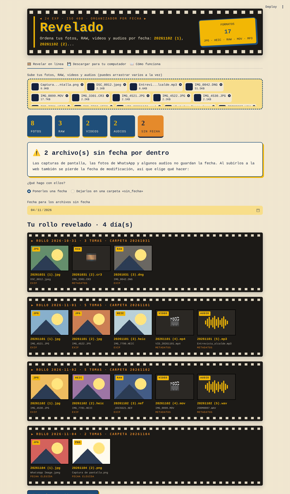

# 🎞️ Revelado · Organizador de fotos, videos y audios por fecha

Aplicativo en Python que ordena el material de un cubrimiento por la fecha en que se tomó: crea una carpeta por día y renombra cada archivo como **`AAAAMMDD (n)`**.

```
20261102/
├── 20261102 (1).jpg     ← primero las JPG
├── 20261102 (2).heic    ← luego HEIC (iPhone)
├── 20261102 (3).png     ← luego PNG
├── 20261102 (4).nef     ← luego RAW
├── 20261102 (5).mov     ← luego videos
└── 20261102 (6).wav     ← y al final audios
```

Dentro de cada grupo los archivos quedan en el orden en que se tomaron, y la numeración es una sola secuencia por día.

**App en línea:** _(pega aquí el enlace de Streamlit cuando la publiques)_



## Formatos

| Tipo | Extensiones | De dónde sale la fecha |
|---|---|---|
| Fotos | `.jpg` `.jpeg` `.png` `.heic` `.heif` | Fecha de toma (EXIF) |
| RAW | `.cr2` `.cr3` `.nef` `.arw` `.dng` `.raf` `.orf` `.rw2` | Fecha de toma (EXIF); el CR3 se lee como video |
| Videos | `.mov` `.mp4` | Fecha de creación del átomo `mvhd`, convertida de UTC a hora de Colombia |
| Audios | `.wav` `.mp3` | WAV: bloque `bext` de grabadoras de campo · MP3: etiquetas ID3 |

Los archivos que no traen la fecha por dentro (capturas de pantalla, fotos de WhatsApp) usan la fecha de modificación en la versión de escritorio. En la versión web, la persona elige una fecha o los deja en la carpeta `sin_fecha`.

## Dos formas de usarlo

### 1. En línea (Streamlit)
Subes los archivos, revisas el rollo con la vista previa de cada día y descargas un **ZIP organizado**. Los archivos no se guardan en el servidor.

### 2. En tu computador (recomendado para muchos archivos o videos pesados)
Trabaja directamente sobre tu carpeta, **sin subir nada a internet**. El permiso consiste en que tú eliges la carpeta; antes de cambiar nada, el programa muestra la vista previa y pide confirmación.

```bash
pip install -r requirements.txt
python organizador_fotos.py                 # abre la ventana para elegir la carpeta
python organizador_fotos.py "D:/Fotos/Evento"   # o con la ruta directa
```

Nunca borra ni sobrescribe archivos, y deja un `registro_organizador.csv` con los nombres originales.

## Estructura del repositorio

```
├── app.py                 # interfaz web (Streamlit), estilo rollo fotográfico
├── organizador_fotos.py   # lógica: tipos, fechas, orden y nombres + versión de escritorio
├── requirements.txt
├── .streamlit/config.toml # colores y límite de subida
└── docs/                  # informe del taller y capturas
```


## Estructuras de control utilizadas

- **if / elif / else:** clasificación por extensión (`tipo_archivo`), orden por tipo (`prioridad`), elección de la fuente de la fecha (`fecha_interna`), confirmación del usuario.
- **for:** recorrido de los archivos de la carpeta, cálculo de nombres, armado del ZIP.
- **while:** validación de la carpeta y de la respuesta, búsqueda de un nombre libre para no sobrescribir, recorrido de los átomos de un video y de los bloques de un WAV.
